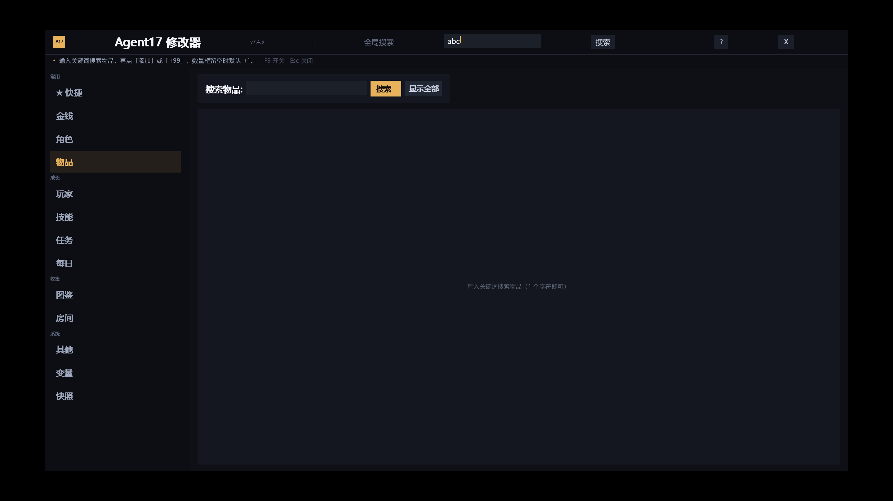
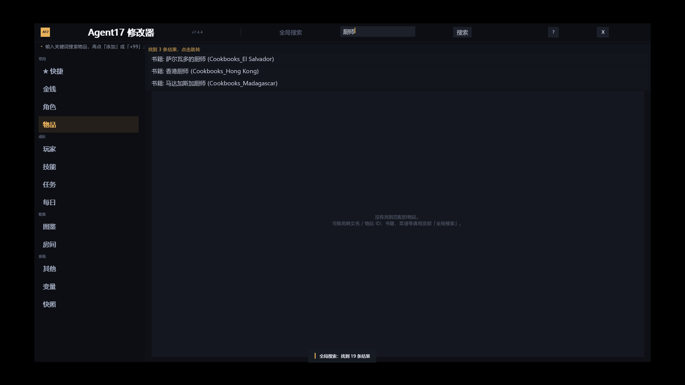

# Agent17 修改器 · 保姆级使用说明

> 不用懂代码、不用装 Python。照着 1 → 2 → 3 做，全程 5 分钟。
> 适用版本：**Agent17 0.26.10**（游戏文件夹名一般是 `特工17Agent17 0.26.10`）

---

## 先看这里：三步就能用

1. **下载** zip → 解压；
2. 把 `cheat_menu.rpy` 复制到游戏目录的 `game\script\ActorScript\`；
3. 开游戏，按 **F9**。

下面每一步都配了说明，卡住了照做就行。

---

## 第 1 步：确认你的游戏版本

打开游戏文件夹，应该能看到：

```
Agent17.exe
game\
renpy\
lib\
```

如果文件夹名字里带 `0.26.10`，就是对的版本。**其他版本不保证能用。**

---

## 第 2 步：下载

打开这个网页：

**https://github.com/YanChen1936/agent17-builtin-mod/releases**

找到最上面的版本，点 `agent17-builtin-mod-v7.4.5.zip` 下载。

> 不用注册 GitHub，直接点就能下。

---

## 第 3 步：先备份（很重要，别跳过）

打开游戏目录里的：

```
game\script\ActorScript\
```

把里面**已有的** `cheat_menu.rpy` 和 `cheat_menu.rpyc`（如果有）复制到桌面。

> 更省事的办法：把整个 `ActorScript` 文件夹复制一份放桌面。
> 出问题时，把备份复制回去就恢复原样了。

---

## 第 4 步：解压，把文件放进去

解压下载的 zip，你会看到：

```
cheat_menu.rpy      ← 要复制的
homemenu.rpy        ← 一般不用管
audio.py            ← 只有“没声音”时才用
使用说明.md          ← 就是你正在看的这份
README.md
docs\               ← 截图，不用管
```

**把 `cheat_menu.rpy` 复制到：**

```
你的游戏目录\game\script\ActorScript\
```

如果那个文件夹里已经有同名文件，选「替换」。

---

## 第 5 步：删掉旧缓存（建议做）

在 `game\script\ActorScript\` 里，如果有 `cheat_menu.rpyc`，**删掉它**。

> 不删一般也行（游戏会自动重新编译），但删了最保险。

---

## 第 6 步：启动游戏

双击 `Agent17.exe`，进入游戏后：

- 主界面点「**修改器**」按钮，或
- 直接按键盘 **F9**

打开后长这样：



关闭：点右上角 **X**，或按 **Esc**。

---

## 第 7 步：30 秒学会用

### ① 快捷页（最常用，一进来就是）

| 想干什么 | 点哪里 |
|---|---|
| 加钱 | 「金币 +1万」 |
| 全角色好感/胁迫/友谊/心情拉满 | 「全角色一键拉满」里的按钮 |
| 全技能满级 | 「全技能满级」 |
| 解锁图鉴 | 「解锁全图鉴」 |
| 跳时间 | 「时间 +1 天」 |
| 怕改坏，先存档 | 「快照存档」 |

点完底部会弹一条提示，告诉你成功没有。

### ② 搜索（顶部「全局搜索」）

可以搜：角色、物品、任务、房间、书籍、图片、音乐……



输入关键词 → 点「搜索」→ 点结果，会自动跳到对应页面。

### ③ 角色页

左边点角色 → 右边改好感/胁迫/心情/身体数值。
底部还有「全角色批量」按钮。

### ④ 改坏了怎么办

先去「快照」页读档；养成习惯：**改大数值之前先点一次「快照存档」**。

---

## 第 8 步：中文打不进去？

游戏输入框不支持中文输入法，这是引擎限制，不是修改器坏了。两个办法：

**办法 A（推荐）：复制粘贴**

1. 在网页/攻略里复制中文（比如 `厨师`）；
2. 点修改器的输入框；
3. 按 **Ctrl + V** 粘贴；
4. 点「搜索」。

**办法 B：不用打字**

物品页点「**显示全部**」，直接浏览全部物品。

---

## 出问题了？按这里排查

### 情况 1：游戏打不开 / 一进就报错

1. 把 `game\script\ActorScript\cheat_menu.rpyc` 删掉，重新启动；
2. 还不行 → 把第 3 步备份的 `cheat_menu.rpy` 复制回去，恢复原版。

### 情况 2：没声音 / 动画变成一张静止图

这是游戏音频初始化失败，不是修改器的问题。把 zip 里的 `audio.py` 复制到：

```
游戏目录\renpy\audio\audio.py
```

覆盖前先把原文件备份。然后再启动游戏。

### 情况 3：按 F9 没反应

先用主界面的「修改器」按钮打开；确认你复制的是 `game\script\ActorScript\cheat_menu.rpy`，不是别的目录。

### 情况 4：想彻底卸载

1. 删除 `game\script\ActorScript\cheat_menu.rpy`；
2. 删除同目录的 `cheat_menu.rpyc`；
3. 把备份的原文件放回去；
4. 结束。

---

## 常见问题

**Q：需要装 Python 或别的软件吗？**
不用，只要游戏本体。

**Q：会弄坏存档吗？**
先点「快照存档」，改坏了读快照就行。修改器不会主动删你的存档。

**Q：游戏以后更新了还能用吗？**
这是给 0.26.10 做的，换版本要等适配。

**Q：杀毒软件报警？**
它就是一个文本脚本（.rpy），可以用记事本打开检查内容。

**Q：为什么有些动画还是不动？**
0.26.10 的资源包本身缺了 34 个动画文件，和修改器无关。

---

## 免责声明

仅供个人单机学习、修改使用，请勿用于商业用途或二次售卖。
